

  

<h1 align="center">Skyward 150</h1>

  <strong>A 150 mm Newtonian telescope you can 3D print and build yourself.</strong> 
  Open source, from <a href="https://www.tentelescopes.com">Ten Telescopes</a> in Guelph, Ontario.

  <a href="https://youtu.be/F4SeQUh-p40">Build video</a> ·
  <a href="Manuals/Skyward%20150%20Assembly%20Manual%20v0.1f.pdf">Assembly manual</a> ·
  <a href="https://discord.gg/kwv2z3wfGd">Discord</a> ·
  <a href="https://tundra3d.ca/products/skyward-150-telescope-kit?utm_source=github&utm_medium=referral&utm_campaign=readme">Get a kit</a>

---

The Skyward 150 was our first Skyward. It's built from durable, easy to find and affordable materials, and the printed parts need no supports. It's a good scope for the Moon, planets, star clusters and Messier objects.

| | |
|---|---|
| **Design** | Newtonian reflector, modified Dobsonian on a tripod |
| **Primary mirror** | 150 mm, f/5, 750 mm focal length (spherical or parabolic) |
| **Focuser** | 1.25" focuser for Newtonian telescopes |
| **Finder** | Red dot finder |
| **Frame (Compact)** | Four 2020 aluminum extrusions, 645 mm |
| **Printed parts** | ABS, ASA or PETG, no supports |

> **Not safe for viewing the Sun.**

## Watch the build

  <a href="https://youtu.be/F4SeQUh-p40">
    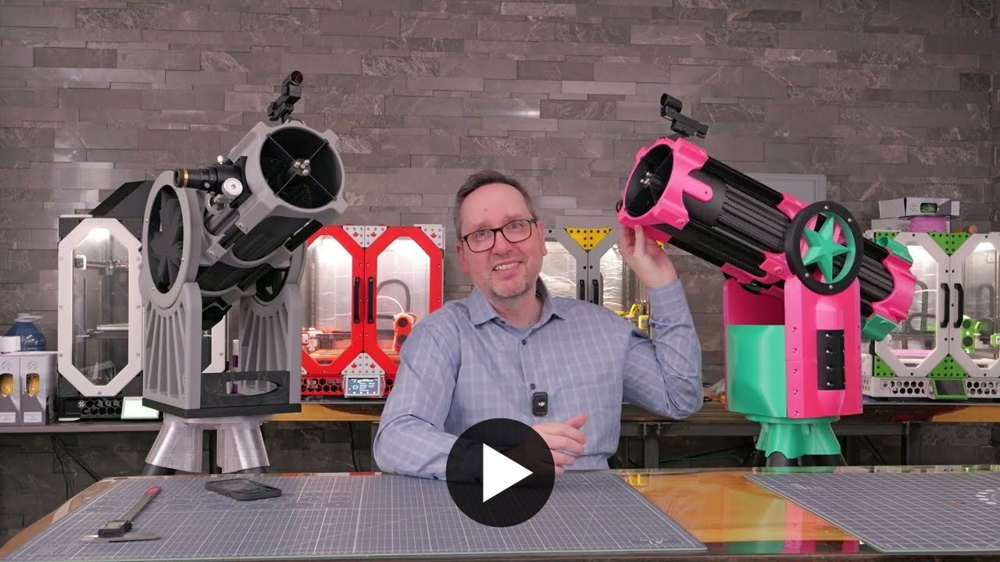
  </a>

The full build video walks through every step: print finishing, threaded inserts, both tripod styles, OTA assembly, balancing, collimation and red dot finder alignment.

## Start here

1. **Watch the [build video](https://youtu.be/F4SeQUh-p40)** to see what's involved.
2. **Check the parts.** The [sourcing guide](BOM%20and%20Print%20List/Skyward%20150%20Compact%20Sourcing%20Guide%20Jan%2013%202026.pdf) lists every screw, insert and optical part.
3. **Print the parts.** Use the [printed parts guide](BOM%20and%20Print%20List/Skyward%20150%20Compact%20Printed%20Parts%20Guide%20Mar%2026%202025.pdf) and the STLs in [`STL Files/Skyward 150 Compact (latest design)`](STL%20Files/Skyward%20150%20Compact%20(latest%20design)). Print the mirror cell first to check your printer's shrinkage against the 150 mm mirror.
4. **Get the optics and hardware.** Source them yourself, or get the [Skyward 150 complete optics and hardware kit](https://tundra3d.ca/products/skyward-150-telescope-kit?utm_source=github&utm_medium=referral&utm_campaign=readme). It includes the mirrors, focuser, aluminum frame, finder, collimator and all the hardware.
5. **Build it.** For the Compact, follow the build video. The [assembly manual](Manuals/Skyward%20150%20Assembly%20Manual%20v0.1f.pdf) covers the Original design.
6. **Ask questions** in [#skyward-build-questions on Discord](https://discord.gg/kwv2z3wfGd). People there have built these.

## Gallery

Skywards out under the sky, in classrooms and on the bench.

  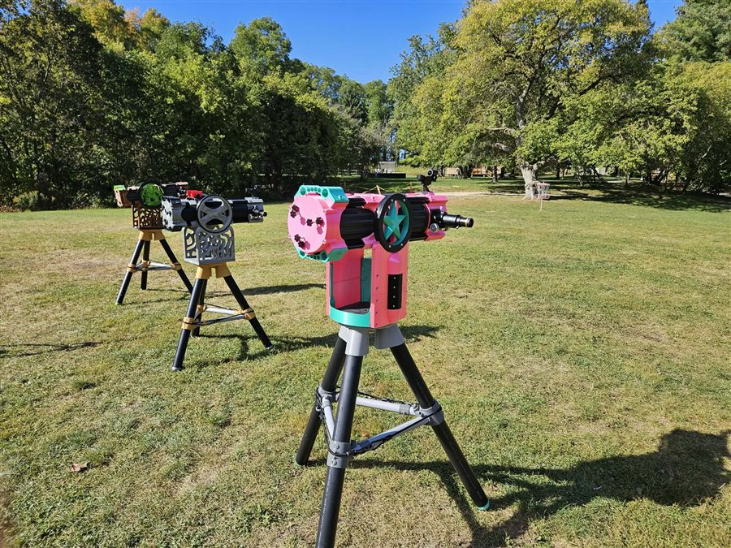
  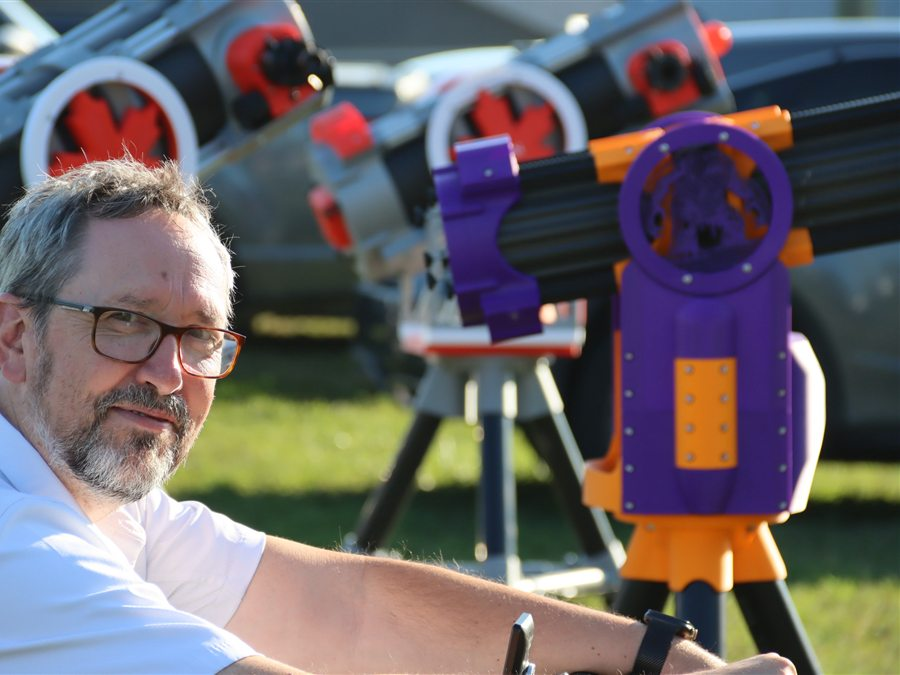
  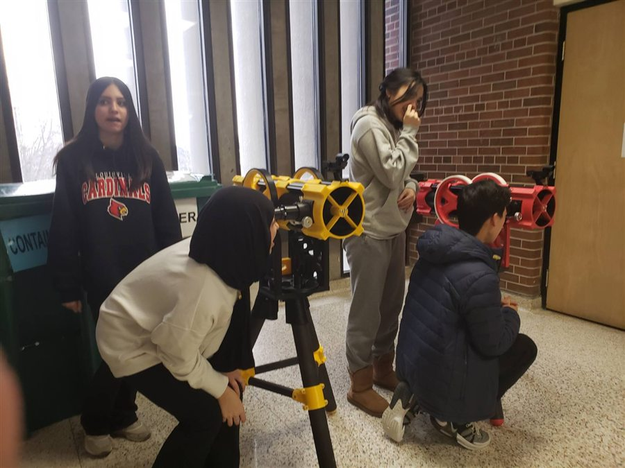

  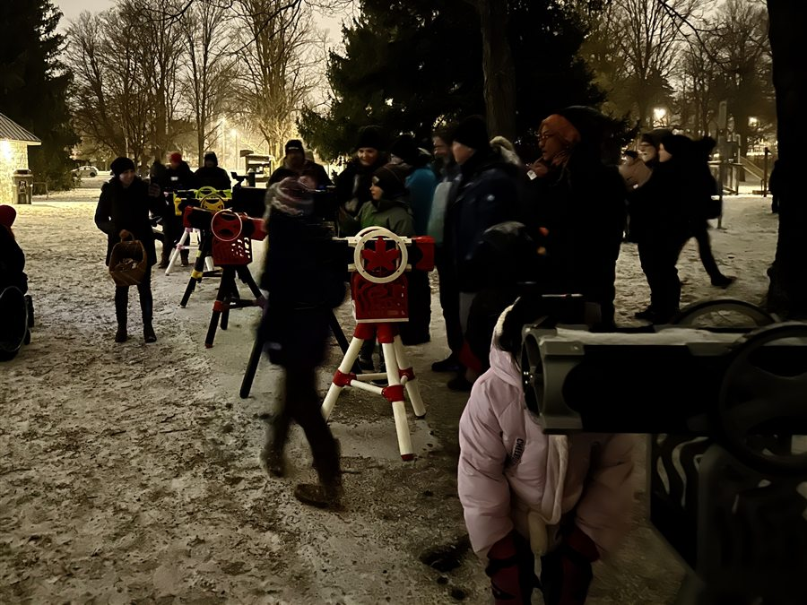
  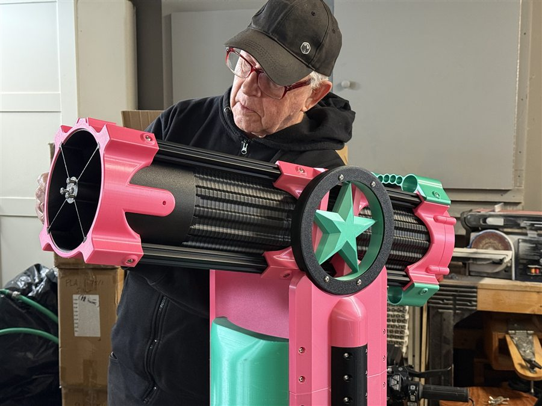
  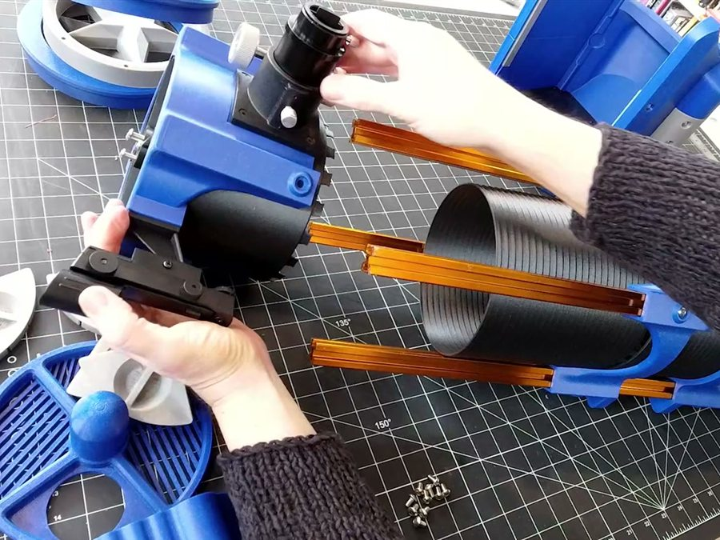

  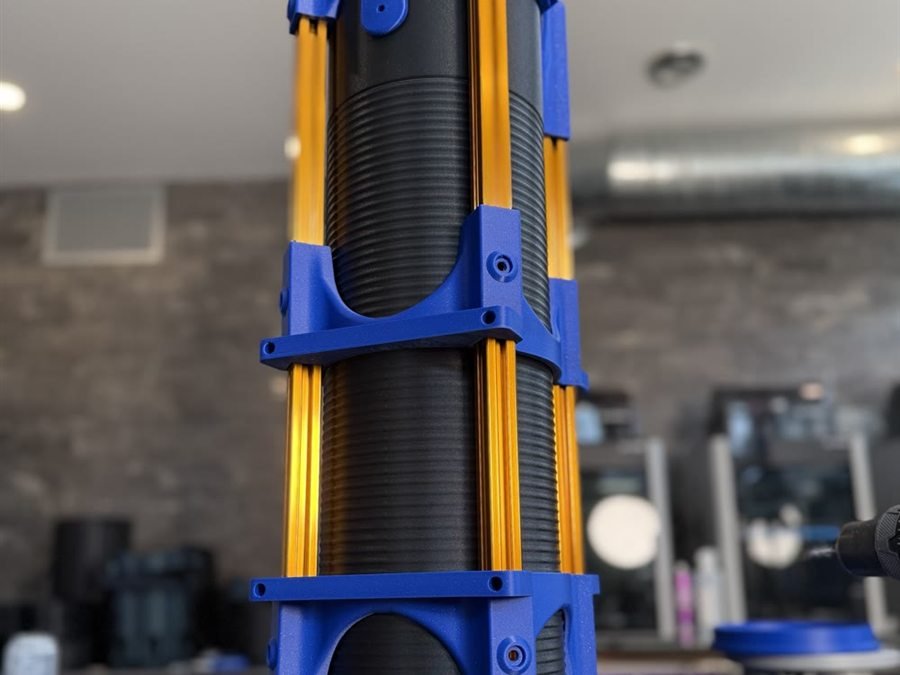
  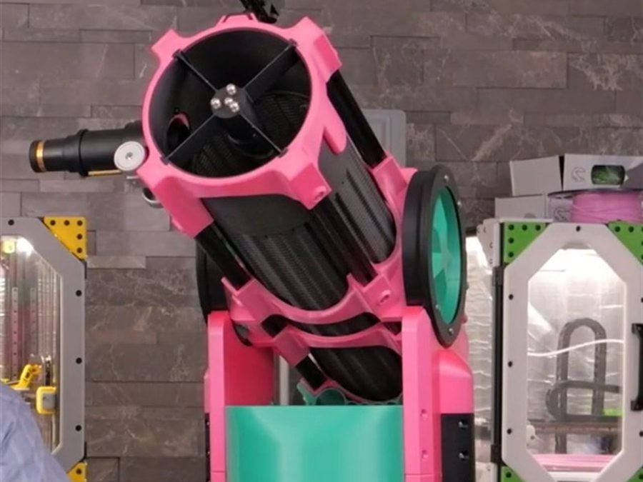
  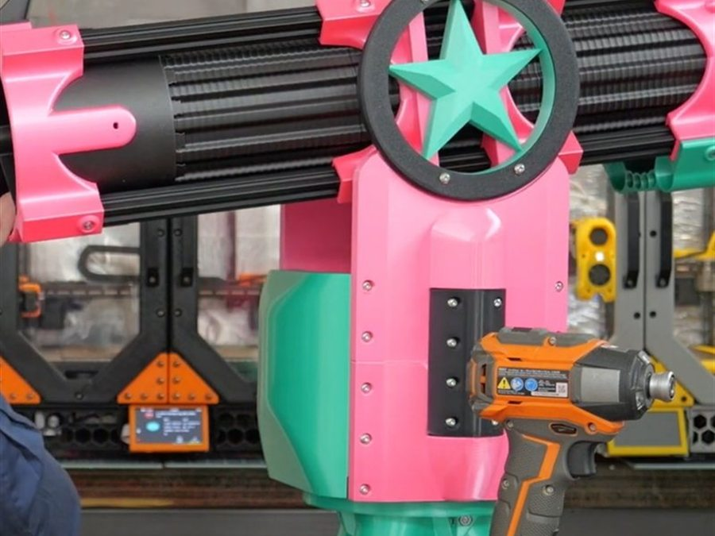

### The Skyward 150 Astrograph

The Astrograph version is built for long exposure astrophotography, with the [Ten Telescopes 2" focuser](https://github.com/TenTelescopes/Ten-Telescopes-2-Inch-Focuser) and room for an autofocuser. The early tube design is in [`STL Files/Skyward 150 Astrograph OTA (alpha)`](STL%20Files/Skyward%20150%20Astrograph%20OTA%20(alpha)).

  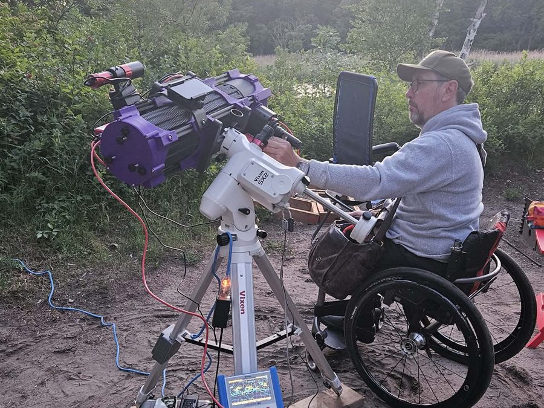
  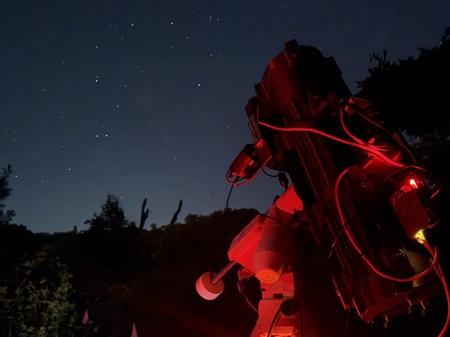
  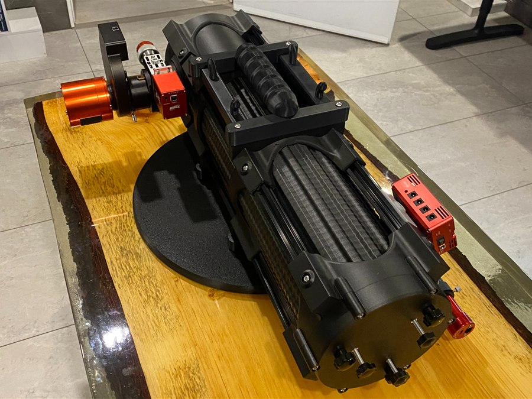

  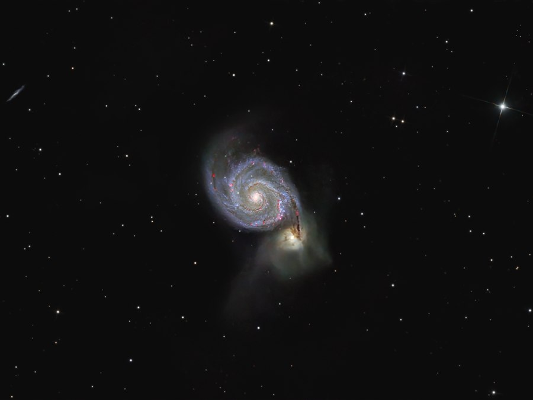
  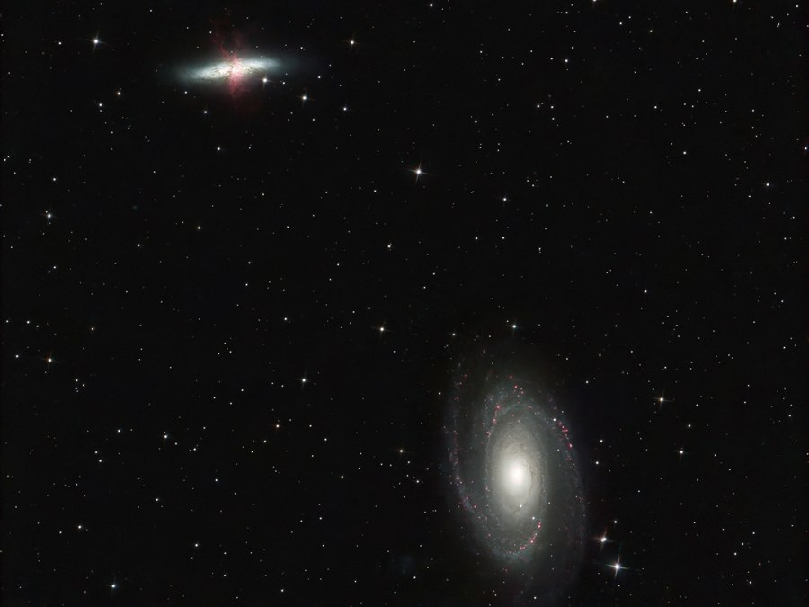
  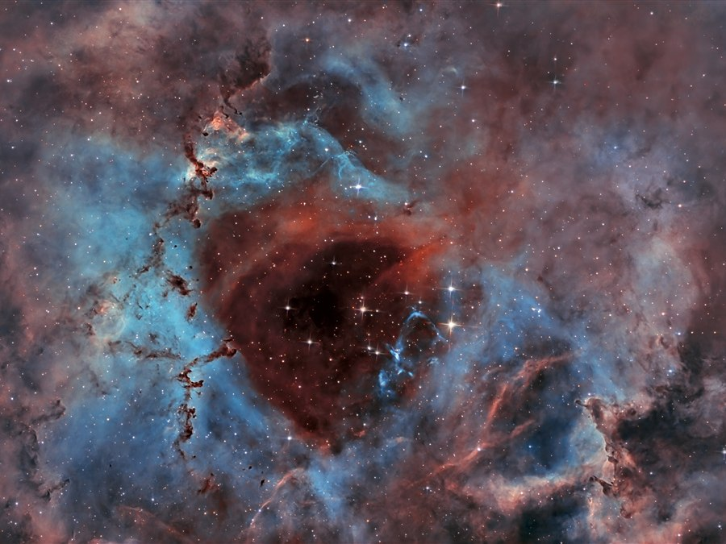

Deep sky images by Vasu Maini. Read how he went from the visual Skyward 150 to these in [Built, Not Bought](https://www.tentelescopes.com/post/built-not-bought).

Built one? Share it in **#skyward-150-build-logs** on [Discord](https://discord.gg/kwv2z3wfGd). We'd love to see it.

## What's in this repo

| Folder | What's inside |
|---|---|
| [`STL Files/Skyward 150 Compact (latest design)`](STL%20Files/Skyward%20150%20Compact%20(latest%20design)) | The current design. Start here. |
| [`STL Files/Skyward 150 Original (legacy design 300mm bed size)`](STL%20Files/Skyward%20150%20Original%20(legacy%20design%20300mm%20bed%20size)) | The original design, for printers with a 300 mm bed |
| [`STL Files/Skyward 150 Astrograph OTA (alpha)`](STL%20Files/Skyward%20150%20Astrograph%20OTA%20(alpha)) | An early astrophotography version of the tube |
| [`STL Files/Community Mods`](STL%20Files/Community%20Mods) | Add-ons made by the community |
| [`STL Files/Tools`](STL%20Files/Tools) and [`Other Accessories`](STL%20Files/Other%20Accessories) | Build tools and extras |
| [`BOM and Print List`](BOM%20and%20Print%20List) | Sourcing guide and printed parts guides |
| [`Manuals`](Manuals) | Assembly manual for the Original design |
| [`CAD Files`](CAD%20Files) | Source CAD for the Compact design |

## License

These designs are licensed under the [Creative Commons Attribution–NonCommercial 4.0 International License](https://creativecommons.org/licenses/by-nc/4.0/).

You are free to:

- Download, modify, and use for personal, non‑commercial purposes.
- Share adaptations with credit to **Ten Telescopes**.

You may **not**:

- Sell these designs.
- Sell physical products made from these designs without written permission.

For commercial inquiries: admin@tentelescopes.com
